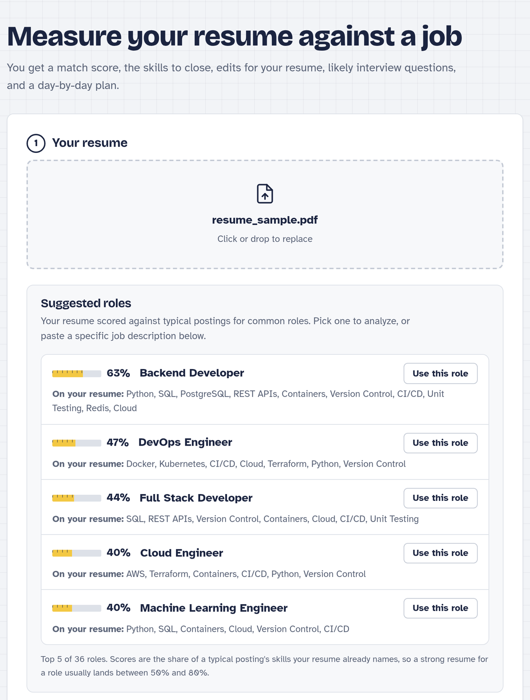
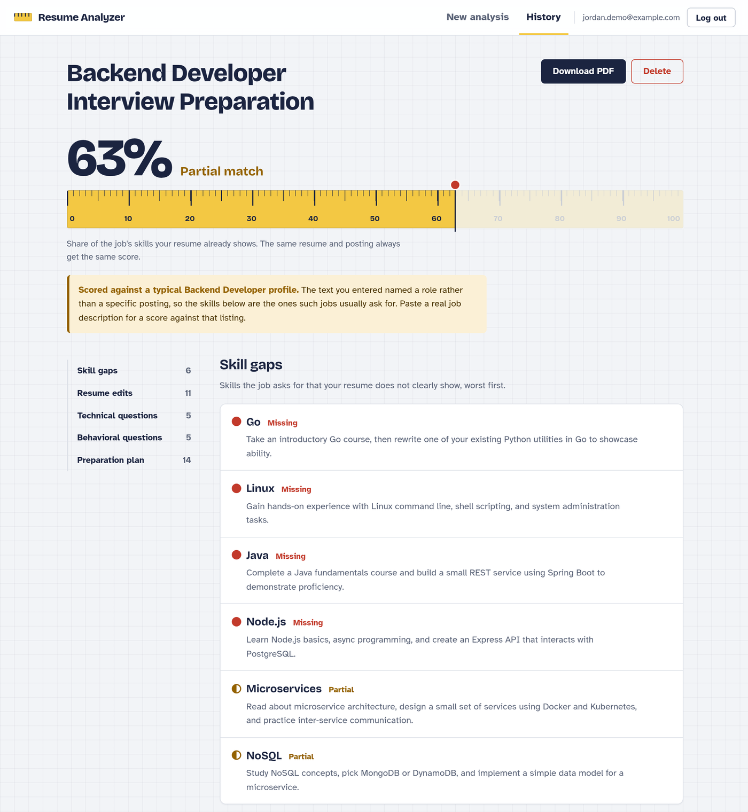
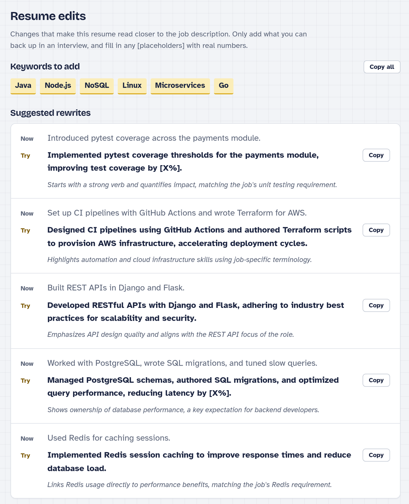
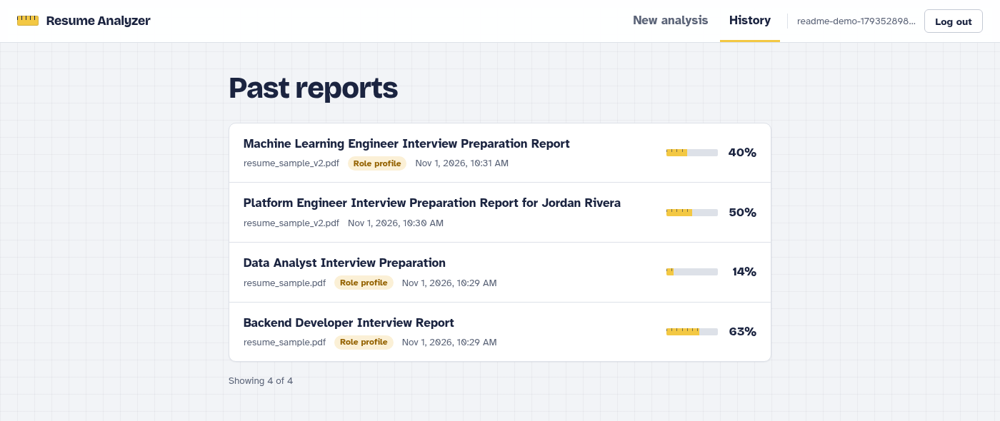
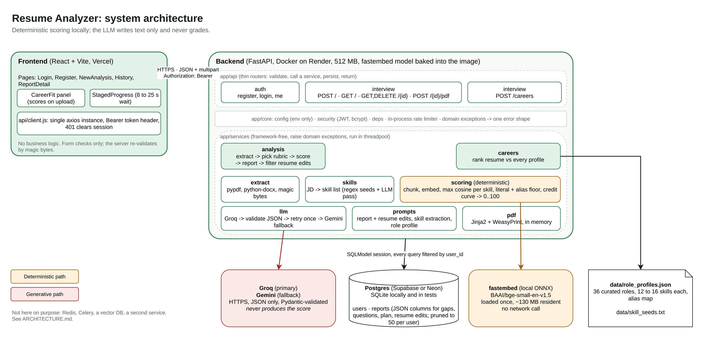
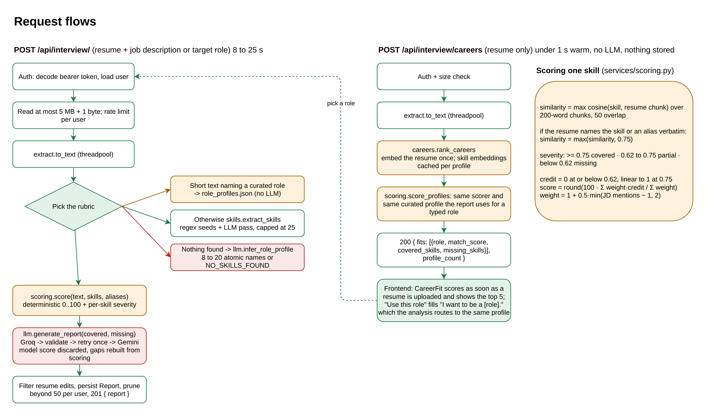

# Resume Analyzer

Upload a resume, paste a job description or just name the role you want,
and get back a structured report: a deterministic match score, a per-skill
gap analysis, edits for the resume itself, technical and behavioral
interview questions, and a day-by-day preparation plan. Save any report as
a PDF. Not sure what to target? As soon as a resume is uploaded, the app
ranks it against 36 curated role profiles and offers the best fits as
one-click targets.

**Live app:** https://resume-analyzer-five-delta-75.vercel.app (API:
https://resume-analyzer-6phf.vercel.app/api/health). Free tiers on Vercel
and Neon; see [Deployment](#deployment) below. The first request after a
quiet spell takes a few extra seconds while the API starts up.



*The new-analysis page right after a resume is uploaded: it is scored
against 36 curated role profiles with no button press, and each suggested
role shows the skills the resume already names. "Use this role" fills the
target box, and the report scores against that same profile.*



*The report for the same resume against the Backend Developer profile: the
same 63% the panel showed, drawn as a tape measure, and the gaps that drive
it. The side rail jumps to each section.*



*Resume edits from the same report: job-description keywords the resume is
missing, and rewrites of its weakest lines. Every "Now" line is checked
against the resume text, so the model cannot rewrite a line that is not
there. The full page continues with interview questions and a 14-day
preparation plan.*



*History: every report shows which resume it measured, whether it scored
against a curated role profile or a pasted job description, when it ran,
and its score, newest first.*

## Why this exists

Most "AI resume tool" side projects are a thin wrapper around a single LLM
call, including the score itself, which means the same resume can score
differently on every run. This one splits the work on purpose:

- **The match score is deterministic.** It comes from local embeddings
  (`BAAI/bge-small-en-v1.5` via fastembed), cosine similarity between the
  resume and each skill the job description asks for, and a weighted
  aggregate. No network call, no temperature, no drift: the same resume and
  job description always produce the same score. The one LLM input to
  scoring, naming the skills a posting asks for, is stored on first use and
  reused, so it cannot drift between runs either.
- **The LLM only generates text that needs generating.** Interview
  questions, the reasoning behind them, the prep plan, and resume edits. It
  never grades anything, and if it tries to return a score, that value is
  discarded. Its resume edits are filtered too: keywords the resume already
  has and rewrites of lines that are not on the resume are dropped.
- **A score of 20% displays as 20%.** Credit for a skill starts at zero
  below the partial threshold, so a resume with none of the skills scores
  near zero rather than the 65 point floor an unanchored cosine similarity
  gives. See DESIGN.md for the formula and the calibration notes.

Three ways to give it a target:

| Input | What it scores against |
| ----- | ---------------------- |
| A pasted job posting | Skills extracted from the posting (regex seed list plus an LLM pass) |
| A role name the app knows ("I want to be an AI Engineer") | The curated profile in `backend/app/data/role_profiles.json`, no LLM call |
| A role name it does not know | A profile the LLM writes on the spot, validated to 8 to 20 atomic skill names |

The career-fit panel and the report use the same scorer and the same
curated profile, so the score you see in the panel is the score the report
gives for that role.

See [ARCHITECTURE.md](ARCHITECTURE.md) for the full system design (with a
draw.io diagram in [docs/architecture.drawio](docs/architecture.drawio)) and
[DESIGN.md](DESIGN.md) for the API contract and scoring formula.

## Architecture



Orange is the deterministic path, red the generative one. The scorer never
calls the network; the LLM never produces a number that reaches the report.



Both images are exported from [docs/architecture.drawio](docs/architecture.drawio),
which is the editable source. The prose version with the reasoning behind
each choice is [ARCHITECTURE.md](ARCHITECTURE.md).

## Stack

| Layer      | Choice                                             |
| ---------- | --------------------------------------------------- |
| Backend    | FastAPI, SQLModel, Alembic                          |
| Scoring    | fastembed (ONNX, `bge-small-en-v1.5`), pure Python   |
| LLM        | Groq (primary), Gemini (fallback)                    |
| Database   | Postgres on Neon, SQLite for local/tests             |
| PDF export | Jinja2 + WeasyPrint in Docker; browser print on Vercel |
| Frontend   | React + Vite, react-router, axios                    |
| Auth       | JWT bearer token (not cookies; see ARCHITECTURE.md)  |
| Hosting    | Vercel (API and frontend) + Neon, all free tiers     |

## Project status

Every phase in [PHASES.md](PHASES.md) is implemented, tested, and deployed:

- **Live** on Vercel and Neon since 2026-11-02 (links at the top). Sign-up,
  career suggestions, a full analysis, history, and the print fallback were
  checked against production, and the live score matched the local one.
- Backend: 126 tests passing. PDF rendering tests skip themselves on a
  machine without WeasyPrint's native libraries; see
  [Running tests](#running-tests).
- Frontend: builds cleanly, lints cleanly.
- LLM providers: both Groq and Gemini keys work and have been exercised
  live end-to-end (real report generation, and a genuine Groq-failure ->
  Gemini-fallback run), not just mocked. Model defaults are `openai/gpt-oss-120b`
  and `gemini-3.6-flash`. Both provider catalogs move fast, so if either
  starts returning 404s, that model has likely been retired; check the
  provider's current model list and update `backend/.env` (and the Vercel
  project's environment variables).
- Scoring has been checked against three real resumes across a dozen
  role targets (Phase 10). That is what moved the partial threshold to 0.62
  and anchored the credit curve; it is still a small set, and the 20-pair
  calibration in `DESIGN.md` remains open.

## Running it locally

### Prerequisites

- Python 3.12+ (3.13 works; the Docker image targets 3.12)
- Node 20+
- A Groq API key and a Gemini API key (both have free tiers) if you want the
  LLM step to actually produce questions instead of failing over to
  `LLM_UNAVAILABLE`

### Backend

```bash
cd backend
python -m venv .venv
source .venv/bin/activate    # Windows: .venv\Scripts\activate
pip install -r requirements.txt
cp .env.example .env         # Windows: copy; then fill in JWT_SECRET, GROQ_API_KEY, GEMINI_API_KEY
uvicorn main:app --reload
```

The API is now at `http://localhost:8000`. Leave `DATABASE_URL` unset (or
at `sqlite:///./dev.db`) for local work: tables are created and new columns
added automatically on startup. Against Postgres, run migrations instead,
over a direct (non-pooled) connection if you use Neon:

```bash
DATABASE_URL_UNPOOLED=<direct connection string> alembic upgrade head
```

Keep production connection strings out of `DATABASE_URL` in your local
`.env`, or local testing writes into the live database.

The app downloads the fastembed model (about 65 MB) on its first start if
it isn't already cached; the Docker image bakes it in at build time.

### Frontend

```bash
cd frontend
npm install
cp .env.example .env.local     # optional; VITE_API_URL defaults to http://localhost:8000/api
npm run dev
```

The app is now at `http://localhost:5173`.

### Running it again later

Once the one-time setup above is done, starting both servers is just:

```bash
# terminal 1, from backend/
source .venv/bin/activate     # Windows: .venv\Scripts\activate
uvicorn main:app --reload

# terminal 2, from frontend/
npm run dev
```

Then open `http://localhost:5173`.

A few things that trip people up:

- **Both servers need to be running at once**, in two separate terminals;
  the frontend can't reach the backend otherwise.
- If PowerShell refuses to run `activate` (a script execution policy
  error), either run `Set-ExecutionPolicy -Scope Process -ExecutionPolicy Bypass`
  first, or activate via `.venv\Scripts\activate.bat` from `cmd.exe` instead.
- `--reload` watches Python files, not `.env`. If you edit `backend/.env`
  (say, to add a real database URL), stop the server (`Ctrl+C`) and start
  it again for the change to take effect.

### Running tests

```bash
cd backend
pytest
ruff check .
ruff format --check .
```

```bash
cd frontend
npm run lint
npm run build
```

PDF export tests are skipped automatically if WeasyPrint's native libraries
(Pango, GDK-Pixbuf, Cairo) aren't installed, which is the normal case on a
bare Windows machine. They run for real in the Docker image, where those
libraries are installed via `apt-get`. To test PDF export locally on
Windows, follow WeasyPrint's
[Windows install steps](https://doc.courtbouillon.org/weasyprint/stable/first_steps.html#windows),
or just build the Docker image.

## Deployment

Everything runs on free tiers with no card: two Vercel projects (the API on
Vercel's Python runtime, the frontend as a static Vite build) and a Neon
Postgres database.

1. **Database:** create a free project on [Neon](https://neon.tech) and copy
   both connection strings: the pooled one (host ends in `-pooler`) for the
   app, and the direct one for migrations.
2. **Migrations:** Vercel has no container start to run them from, so apply
   them from your machine before deploying anything that adds one:
   `DATABASE_URL_UNPOOLED=<Neon direct> alembic upgrade head` in `backend/`.
3. **API project:** import this repository on Vercel with root directory
   `backend`. Vercel finds the FastAPI `app` in `main.py`; `backend/vercel.json`
   allows 300 s per request. Set `DATABASE_URL` (Neon pooled),
   `GROQ_API_KEY`, `GEMINI_API_KEY`, `JWT_SECRET` (`openssl rand -hex 32`),
   and `CORS_ORIGINS` (the frontend's URL).
4. **Frontend project:** a second import with root directory `frontend`,
   preset Vite, and `VITE_API_URL` set to the API project's URL plus `/api`.
   `frontend/vercel.json` rewrites client-side routes to `index.html`.

**What changes on Vercel:**

- **PDF export:** Vercel's runtime lacks WeasyPrint's native libraries, so
  the API answers `PDF_UNAVAILABLE` and the frontend opens the browser's
  print dialog instead. A print stylesheet lays the report out for paper,
  model answers included. The Docker image still renders PDFs on the server.
- **Rate limits:** against Postgres they are kept in a `rate_hits` table,
  because a serverless host runs several short-lived copies of the app that
  would each keep their own in-memory count.
- **Embedding model:** downloaded to `/tmp` on a cold start (about 65 MB)
  rather than baked into an image, so the first request after idle is a few
  seconds slower.

**Docker alternative:** `backend/Dockerfile` and `render.yaml` still
describe a Render deploy (a free web service that needs a card on file),
which runs migrations on container start and renders PDFs server-side.
`docs/deployment-log.md` records why Vercel was chosen.

## Known limitations

- **No refresh tokens, password reset, or email verification.** Sessions
  last 24 hours; expiry just logs you out. See ARCHITECTURE.md for why.
- **Scoring is keyword coverage, honestly labelled.** A skill counts as
  covered when the resume names it (or a listed alias) or the embedding
  similarity clears 0.75. Short names against long resume chunks rarely
  clear that bar on similarity alone, so in practice the score is close to
  "share of the profile's skills your resume names". A strong candidate
  usually lands between 50% and 80%. Thresholds were adjusted on three real
  resumes; a wider calibration set is still open.
- **Curated role profiles are a starting set.** 36 roles, drafted by the
  LLM once and reviewed by hand. Expect a few false positives from ordinary
  words as real resumes come through, and fix them in the JSON, not in code.
- **PDF export on the live site is the browser's Save as PDF.** Vercel has
  no PDF engine, so "Download PDF" opens the print dialog with a print
  stylesheet. Self-hosting the Docker image gives server-rendered PDFs.
- **Cold starts.** After a quiet spell the API takes a few extra seconds to
  start (Python plus the embedding model), and Neon resumes its compute.
- **Rate limits fail open.** They live in Postgres (`rate_hits`); if that
  check errors, the request is allowed and a warning is logged, so a
  database blip never locks users out.
- **Resume edits are suggestions, not a new file.** The app tells you which
  keywords to add and how to reword lines; you copy them into your own
  resume. It does not generate or edit the document.
- **No job scraping or multi-resume comparison.** Out of scope for v1; see
  `DESIGN.md`.

## Repository layout

See [STRUCTURE.md](STRUCTURE.md) for the full file-by-file layout and the
rules for each directory.

## License

Personal / portfolio project. No license file yet; ask before reusing.
